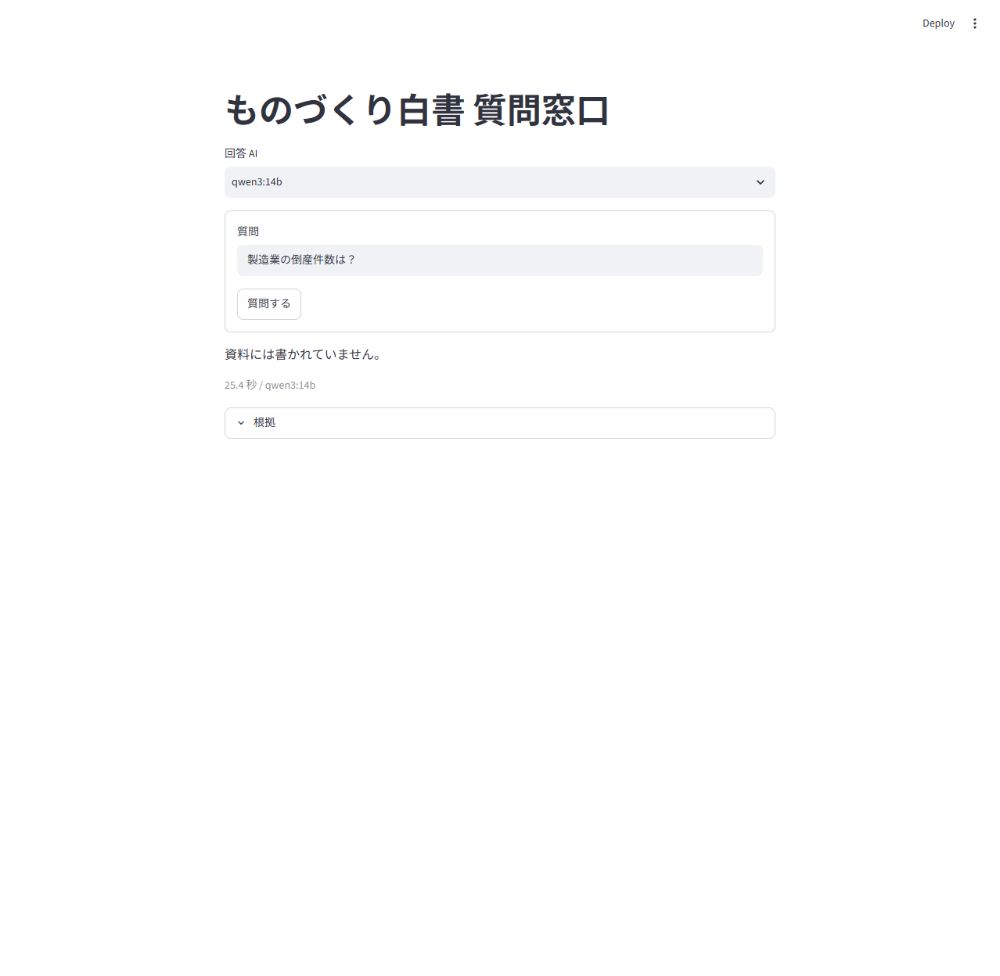
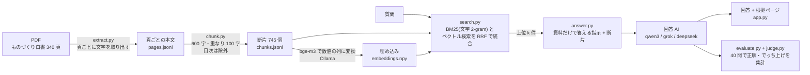

# ものづくり白書 質問窓口（RAG チャットボット）

「ものづくり白書」（経済産業省、全 340 ページの PDF）について質問すると、白書の該当箇所を探し、根拠の紙面ページ付きで答える Streamlit（Python の画面作成ライブラリ）アプリです。
白書に書かれていないことを聞かれたら、答えを作らず「資料には書かれていません」と返す作りにしています。
RAG（検索拡張生成。先に資料から関連部分を探し、それを AI に渡して回答させる方式）の、分割・検索・回答・評価までを自前のコードで組み、効いた改善と効かなかった改善を数字で記録しています。

## 画面



## 構成図



- BM25: 質問の言葉が多く出る断片を上位にする、昔ながらの検索の計算式。
- RRF（順位統合）: 2 つの検索方式の順位を足し合わせて 1 つの順位にする方法。
- 埋め込み: 文章を意味が近いほど近くなる数値の列に直したもの。

## 成績の要約

40 問（段 2 の 20 問 + 段 4 で足した難しい 20 問。資料に無い話題の問を 8 問含む。内訳は docs/段2・段4）。判定は glm（別の AI）が行い、全条件で共通です。詳細は docs/段4_改善.md、docs/段4b_図表.md、docs/比較.md。

| 条件 | 正解 | 部分正解 | 不正解 | でっち上げ | 出典 |
|---|---|---|---|---|---|
| qwen3:8b（基準） | 21/40 (52%) | 10 | 8 | 1 | 段 4 |
| qwen3:14b（基準） | 21/40 (52%) | 11 | 5 | 3 | 段 4 |
| deepseek v4-pro（基準） | 27/40 (68%) | 9 | 4 | 0 | 段 4 |
| grok 4.6（基準） | 30/40 (75%) | 8 | 2 | 0 | 段 4 |
| qwen3:14b + 検索 k=8（最終のローカル構成） | 24/40 (60%) | 9 | 6 | 1 | 段 4 |

改善の結果（qwen3:14b、正解数）:

| 試した改善 | 結果 | 採否 |
|---|---|---|
| 検索の上位件数 k を 5 から 8 | 21 から 24 | 採用（断片の Hit 27/32 から 30/32） |
| 断片の頭に見出しを付ける | 21 から 22（8b は 21 から 20） | 不採用（誤差の範囲） |
| 計算を Python に任せる | 21 から 21（8b は 21 から 19） | 不採用 |
| 崩れた図表を画像から起こして検索に足す | 24 から 19 | 不採用（段 4b） |

限界: 問題は 40 問と少なく、判定役の判定も揺れるため、1〜3 問の差は誤差として扱っています。詳しくは docs/レポート.md。

## 動かし方

前提: Python 3.x、[Ollama](https://ollama.com/)（ローカルで AI を動かす道具）、GPU メモリ 12GB 程度（qwen3:14b を使う場合）。

```bash
# 1. 仮想環境（ライブラリを隔離する入れ物）と依存ライブラリ
python -m venv .venv
.venv\Scripts\activate            # Mac/Linux は source .venv/bin/activate
pip install -r requirements.txt

# 2. Ollama でモデルを取得（検索用の bge-m3 と、回答用の qwen3）
ollama pull bge-m3
ollama pull qwen3:14b

# 3. 白書の PDF を data/raw/all.pdf に置く
#    https://www.meti.go.jp/report/whitepaper/mono/2024/pdf/all.pdf
#    （自動取得は 403 で拒否されたため、ブラウザで保存してください）

# 4. 文字の取り出しと分割（埋め込みは初回の検索時に自動で作られ、保存されます）
python src/extract.py
python src/chunk.py

# 5. 画面を起動
streamlit run src/app.py
```

評価を再現する場合（例: qwen3:14b で検索 k=8）:

```bash
python src/evaluate.py run qwen3-14b 改善c_k8 --k 8
python src/judge.py 改善c_k8 qwen3-14b
python src/evaluate.py report 改善c_k8
```

注意:
- grok / deepseek は作者の手元の呼び出し用スクリプト（ask.py）経由のため、そのままでは動きません。ローカルの qwen3 は上の手順だけで動きます。
- Gemini と Claude の呼び出しコードは入っていますが、キーの問題で今回は評価していません。キーは環境変数に置き、ファイルに書かないでください。
- 画面（src/app.py）は評価の最終構成（検索の上位 8 件、計算の Python 化なし）で動きます。
- PDF 読み取りに使う PyMuPDF は AGPL（公開時に条件を守る必要があるライセンス）です（docs/段1）。

## フォルダ構成

```
rag-chatbot/
  README.md          この文書
  PLAN.md            計画
  requirements.txt   依存ライブラリ
  src/
    extract.py       PDF から頁ごとに文字と表を取り出す
    chunk.py         断片に分ける（600 字・重なり 100 字、見出し付きは --heading）
    search.py        自前 BM25 + bge-m3 + RRF
    answer.py        プロンプト作成と回答 AI の呼び出し、計算の Python 化
    evalset.py       評価問題の追加と、正解語句が本文にあるかの確認
    evaluate.py      40 問を流して記録・集計
    judge.py         判定役（glm、失敗時は grok）
    figure.py        崩れた図表ページの画像化と読み取り（段 4b）
    app.py           Streamlit の画面
  data/              評価問題 eval.jsonl、断片、埋め込みなど（PDF 本体 data/raw/ は含めない）
  results/           各条件の回答と判定の記録（jsonl とログ）
  docs/
    レポート.md      課題 8 項目への回答
    段1〜段4b, 比較.md  各段の記録
    画面.png         画面の撮影
```
